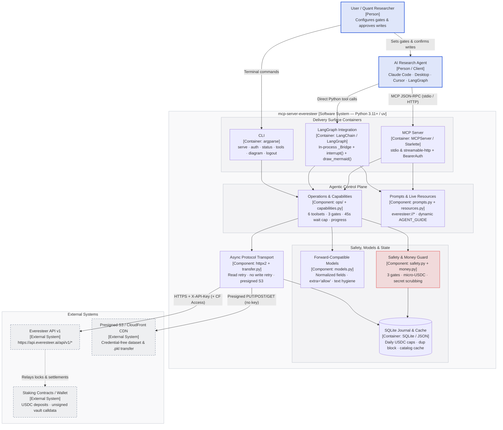
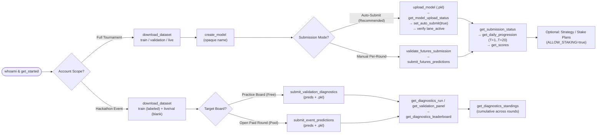
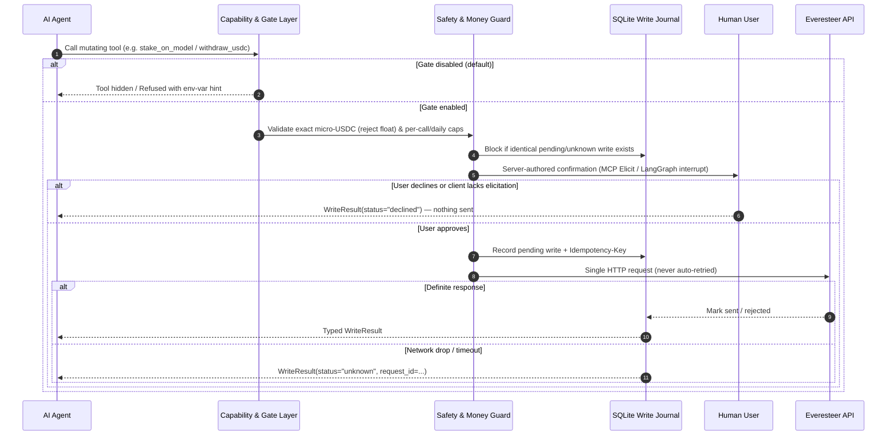
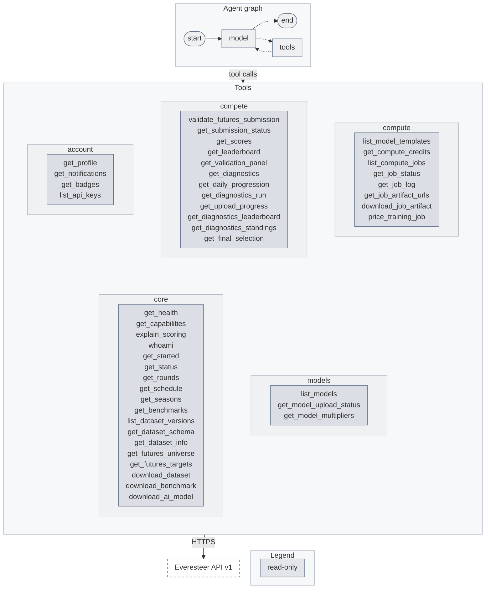

<!-- mcp-name: io.github.tukorama/mcp-server-everesteer -->

# MCP server and LangGraph tools for Everesteer

[](https://pypi.org/project/mcp-server-everesteer/)
[](https://github.com/tukorama/mcp-server-everesteer/actions/workflows/ci.yml)
[](https://github.com/tukorama/mcp-server-everesteer/blob/main/LICENSE)

`mcp-server-everesteer` is an agent-first [Model Context Protocol (MCP)](https://modelcontextprotocol.io) server and [LangGraph](https://langchain-ai.github.io/langgraph/) / LangChain toolkit for the [Everesteer](https://everesteer.ai) prediction tournament API (`https://api.everesteer.ai`). Unofficial, and not affiliated with Everesteer.

## Why this exists

Driving Everesteer from an autonomous coding or research agent breaks down when the platform SDK mixes plotting, dataframe libraries, and unguarded HTTP writes into one synchronous module. This project separates concerns cleanly:

| Area | Official `everesteer-api` (0.5.0) | `mcp-server-everesteer` |
|---|---|---|
| **Layering** | 2,778-line sync `client.py` + 3,600-line MCP wrapper | 6-layer async architecture: transport → safety/journal → models → ops → prompts/resources → MCP / LangGraph / CLI |
| **Control plane vs. modeling** | Bundles `plotnine`/`matplotlib`, ASCII table formatters, `numpy`/`pandas`/`scipy`, and deprecated shims | **Zero** visualization, **zero** plotting, **zero** ML/dataframe dependencies (`httpx2`, `mcp`, `pydantic`, `starlette`, `uvicorn`) |
| **Agent token economy** | Multi-paragraph essays duplicated across raw tool schemas | Consolidated agentic tools in 6 cohesive toolsets + live `everesteer://*` resources + dynamic `agent_guide` |
| **Write & money safety** | Unguarded writes, no caps, no confirmation, no write journal | 3 default-closed gates (`ALLOW_WRITES`, `ALLOW_STAKING`, `ALLOW_WITHDRAWALS`), micro-USDC integer validation (floats refused), daily SQLite caps, MCP Elicitation + LangGraph `interrupt()` |
| **Long operations** | Blocking `time.sleep` loops that time out in Claude Desktop | Async polling with MCP progress notifications and a **45 s client wait cap** returning resumable `pending` state |
| **LangGraph** | Not supported | Native `[langgraph]` extra (`get_everesteer_tools`, `create_everesteer_agent`, `draw_mermaid`) with `Command(resume=...)` approvals |

## Architecture



## Model & Tournament Lifecycle



## Write & Money Guardrails



---

## End-to-End User Walkthrough

All examples use [`uv`](https://docs.astral.sh/uv/) (Python 3.11+). Nothing needs to be installed globally unless you want to.

### Step 1 — Configure Authentication & Verify Tools

Store your Everesteer API key once (`0600` file permissions under `~/.config/mcp-server-everesteer/credentials.json`):

```bash
uvx mcp-server-everesteer auth
```

Pass `--no-verify` to store a key offline, or `--cf-access` if targeting a staging host protected by Cloudflare Access (`CF-Access-Client-Id` / `CF-Access-Client-Secret`). You can also pass `EVERESTEER_API_KEY` (or `EIQ_API_KEY`) directly via environment variables.

Inspect your connection, key fingerprint, open gates, and available tools:

```bash
uvx mcp-server-everesteer status
uvx mcp-server-everesteer tools
```

By default (with an API key and all 3 write gates disabled), **45 read-only tools** are exposed and all mutating, staking, withdrawal, and destructive tools stay hidden until explicitly enabled.

### Step 2 — Connect Your MCP Client

#### Claude Code

Add it to any Claude Code project in one command (uses the key saved in `uvx mcp-server-everesteer auth`, or pass `-e EVERESTEER_API_KEY=...` inline):

```bash
# Inside your project directory (project-scoped, reads saved credentials from `auth`):
claude mcp add everesteer --scope project -- uvx mcp-server-everesteer

# Or directly from GitHub (works even before PyPI publish):
claude mcp add everesteer --scope project -- \
  uvx --from git+https://github.com/tukorama/mcp-server-everesteer mcp-server-everesteer

# Or pass the key explicitly and enable writes when ready:
claude mcp add everesteer \
  -e EVERESTEER_API_KEY=eiq_your_api_key \
  -e EVERESTEER_ALLOW_WRITES=true \
  -- uvx mcp-server-everesteer
```

Or drop a committable `.mcp.json` at the root of your Claude Code repository (no secrets inside when combined with `uvx mcp-server-everesteer auth`), then verify with `claude mcp list` or `/mcp` inside Claude Code:

```json
{
  "mcpServers": {
    "everesteer": {
      "command": "uvx",
      "args": ["mcp-server-everesteer"]
    }
  }
}
```

#### Cursor

Create `.cursor/mcp.json` inside your project (or `~/.cursor/mcp.json` globally):

```json
{
  "mcpServers": {
    "everesteer": {
      "command": "uvx",
      "args": ["mcp-server-everesteer"],
      "env": {
        "EVERESTEER_API_KEY": "eiq_your_api_key"
      }
    }
  }
}
```

#### Claude Desktop

Add `everesteer` to `~/Library/Application Support/Claude/claude_desktop_config.json` (macOS) or `%APPDATA%\Claude\claude_desktop_config.json` (Windows):

```json
{
  "mcpServers": {
    "everesteer": {
      "command": "uvx",
      "args": ["mcp-server-everesteer"],
      "env": {
        "EVERESTEER_API_KEY": "eiq_your_api_key"
      }
    }
  }
}
```

> Blocking waits (`train_model(wait=True)`, `upload_model(wait=True)`) are automatically capped at **45 s** for `claude-desktop` and return a clean resumable `pending` state instead of hitting client timeouts.

#### VS Code (GitHub Copilot Agent Mode)

Add `.vscode/mcp.json` in your workspace (note the `"servers"` key):

```json
{
  "servers": {
    "everesteer": {
      "type": "stdio",
      "command": "uvx",
      "args": ["mcp-server-everesteer"],
      "env": {
        "EVERESTEER_API_KEY": "eiq_your_api_key"
      }
    }
  }
}
```

#### ChatGPT (Custom MCP Connector & OpenAI Agents SDK)

ChatGPT Web / Desktop (**Settings → Connectors / Developer mode → Custom MCP**) requires a **remote HTTPS `streamable-http`** endpoint (`https://<your-domain>/mcp`) rather than local `stdio`:

```bash
EVERESTEER_API_KEY=eiq_your_api_key \
EVERESTEER_HTTP_BEARER_TOKEN=replace-with-strong-secret \
  uvx mcp-server-everesteer serve --transport streamable-http --host 0.0.0.0 --port 8000
```

Put that behind TLS (Caddy, Nginx, Cloudflare Tunnel, Fly.io, Cloud Run, etc.) and configure ChatGPT with:

- **MCP Server URL:** `https://<your-domain>/mcp`
- **Authentication:** Bearer Token (`replace-with-strong-secret`)

The server refuses to bind to a non-loopback address without `EVERESTEER_HTTP_BEARER_TOKEN`. `/health` stays open for liveness probes while `/mcp` enforces constant-time bearer auth. For programmatic OpenAI Agents SDK apps running locally, use `MCPServerStdio` with `uvx mcp-server-everesteer` or `MCPServerStreamableHttp`.

> Before publishing to PyPI (or from a local checkout), replace `"uvx mcp-server-everesteer"` in any snippet above with `"uvx --from /path/to/mcp-server-everesteer mcp-server-everesteer"` or `"uvx --from git+https://github.com/tukorama/mcp-server-everesteer mcp-server-everesteer"`.

### Step 3 — Read-Only Orientation & Data Downloads (Safe Default)

Start your agent with a read-only prompt:

> "Call `whoami`, `get_started`, and `explain_scoring`. Fetch `get_dataset_schema`, download the futures `train` split and `train` benchmark, and explain how to score a holdout split locally."

Key platform facts surfaced by the control plane:

- **Live constant `b`:** Always read `weights.score_multiple_constant` from `explain_scoring` rather than hardcoding a stale constant.
- **Missing feature sentinel:** Feature value **`-1` always means MISSING** across every dataset. Map `-1` to `NaN` or a distinct category in your local modeling code; never treat it as an ordinal value below bin `0`.
- **Blanked hackathon splits:** For event-scoped keys, `train` is labeled while `validation` and `live` ship with blank (`NaN`) target columns.

### Step 4 — Enable Operational Writes & Submit Models

Add `"EVERESTEER_ALLOW_WRITES": "true"` in your MCP client's `env` block (or shell environment — workspace `.env` files cannot unlock any safety gate) to expose the 20 model/submission/compute/account write tools.

**Live Tournament Auto-Submit (Recommended):**

1. `create_model` (omit `name` to receive a server-generated opaque name so public leaderboards never leak your model family).
2. Train locally in your Python environment and serialize a `cloudpickle` callable `predict(live_features)` (or `predict(live_features, live_benchmark_models)`, where `live_benchmark_models` is `eiq_minera_model`; offline benchmark files use `v1_sherpa`) returning a single-column `pandas.DataFrame` with finite values in `[0, 1]`. Supported sandbox runtimes (`3.11` default, `3.12`, `3.13`) and pin URLs are reported live by `get_started`.
3. `upload_model(model_id=..., file_path="model.pkl", python_version="3.12")` — streams straight to presigned storage without hitting API proxy size limits — or deploy directly from hosted compute via `train_model(deploy_to_model_id=...)` / `upload_model(model_id=..., from_job_id=...)`.
4. Poll `get_model_upload_status` until `validated`, call `set_auto_submit(model_id=..., enabled=True)`, and verify `lane_active: true` in `list_models`.

**Manual Futures Submission Fallback:**

1. Run `validate_futures_submission(predictions=...)` or `validate_futures_submission(predictions_path="live_preds.parquet")` first (read-only, checks universe coverage and `[0, 1]` finiteness).
2. Call `submit_futures_predictions(model_id=..., predictions=...)` (or `predictions_path=...`, optional `data_datestamp=...`; omit `exped` to auto-resolve the open round; never pass `"current"`).

**Hackathon Event Loop:**

- **Practice board (free):** `submit_validation_diagnostics(model_id=..., file_path="val_preds.parquet", model_pkl_path="model.pkl")` for `split="validation"` IDs.
- **Paid event round:** `submit_event_predictions(...)` for `split="live"` IDs. This pauses for human confirmation because it consumes your fixed, non-replenished per-event upload pool.

### Step 5 — Cost-Safe Hosted Compute

1. **Always price first (works even in read-only mode):** Call `price_training_job(model="lightgbm", features="small", gpu="CPU")` — sends `dry_run=true` without reserving credits.
2. **Launch training (requires `EVERESTEER_ALLOW_WRITES=true` + confirmation):** Call `train_model(...)`. Pass `wait=True` to poll with progress updates (automatically capped at 45 s on Claude Desktop, returning `status="pending"` cleanly so you can resume with `get_job_status` and `get_job_log`).
3. **Download artifacts:** Call `download_job_artifact(job_id=..., kind="model")` to fetch the `.pkl` via a credential-free presigned S3 request.

### Step 6 — Guardrailed Staking & Withdrawals

Staking and withdrawal tools sit in the `staking` toolset and stay hidden until you open their gates in your real process environment:

```json
{
  "env": {
    "EVERESTEER_ALLOW_STAKING": "true",
    "EVERESTEER_ALLOW_WITHDRAWALS": "true",
    "EVERESTEER_MAX_STAKE_USDC": "50",
    "EVERESTEER_MAX_WITHDRAW_USDC": "50",
    "EVERESTEER_MAX_DAILY_USDC": "200"
  }
}
```

- **Audit first:** Run the `review_staking` prompt (`get_profile` for `email_verified_at`, `get_wallet_status` for 24 h withdrawal cooling, `get_staking_strategy`, `get_staking_plans`, `get_staking_positions`, `list_unconfirmed_writes`), then configure per-model plans (`constant` or `compound`) via `set_staking_plan`.
- **Exact money types:** Always pass USDC as a decimal string (`"25.5"`) or integer micro-USDC (`amount_micro=25_500_000`). Binary floats are rejected locally before touching the network.
- **Mandatory confirmation & SQLite journal:** Every staking/allocation/claim/withdrawal asks for human confirmation via MCP Elicitation (or LangGraph `interrupt()`). Withdrawal and destructive confirmations (`withdraw_usdc`, `freeze_withdrawals`, `archive_model`, `revoke_api_key`, `delete_diagnostics_run`) cannot be skipped even if `EVERESTEER_CONFIRM=none`.

### Step 7 — LangGraph, LangChain, and Auto-Generated Diagrams

Install the `langgraph` extra to run all tools in-process with zero MCP subprocess overhead:

```bash
uv add "mcp-server-everesteer[langgraph]"
```

```python
from langgraph.types import Command
from mcp_server_everesteer.integrations.langgraph import (
    create_everesteer_agent,
    draw_mermaid,
    get_everesteer_tools,
)

agent = create_everesteer_agent("anthropic:claude-sonnet-4-5")
config = {"configurable": {"thread_id": "run-1"}}

result = await agent.ainvoke(
    {"messages": [("user", "Check my Everesteer status and scoring constants.")]},
    config=config,
)
while result.get("__interrupt__"):
    pause = result["__interrupt__"][0].value
    answer = input(f"{pause['message']} [y/N] ").strip().lower() == "y"
    result = await agent.ainvoke(Command(resume=answer), config=config)

# Or use plain LangChain tools in a custom graph (pass include_gated=True if you handle interrupts):
tools = get_everesteer_tools(toolsets="auto,+staking", prefix="ev_")
```

See [examples/langgraph_agent.py](https://github.com/tukorama/mcp-server-everesteer/blob/main/examples/langgraph_agent.py) (both native and `--mcp` modes) and the deployable LangGraph Platform app in [examples/langgraph_app](https://github.com/tukorama/mcp-server-everesteer/tree/main/examples/langgraph_app).

Generate up-to-date Mermaid diagrams anytime from your current configuration:

```bash
uvx mcp-server-everesteer diagram --kind architecture --fence
uvx mcp-server-everesteer diagram --kind lifecycle --fence
uvx mcp-server-everesteer diagram --kind safety --fence
uvx mcp-server-everesteer diagram --kind tools --fence
```

`draw_mermaid(agent)` renders the exact compiled LangGraph and its active toolset boxes (`read`, `write`, `funds`, `destructive`). For the default read-only agent with an API key configured:



---

## Tools, Resources, and Prompts

Choose toolsets with `EVERESTEER_TOOLSETS`: `auto` (default), `all`, comma-separated names, or adjustments such as `auto,+staking,+equities,-compute`.

| Toolset | Gate | Tools |
|---|---|---|
| `core` *(auto)* | None / API key | `get_health`, `get_capabilities`, `explain_scoring`, `whoami`, `get_started`, `get_status`, `get_rounds`, `get_schedule`, `get_seasons`, `get_benchmarks`, `list_dataset_versions`, `get_dataset_schema`, `get_dataset_info`, `get_futures_universe`, `get_futures_targets`, `download_dataset`, `download_benchmark`, `download_ai_model` |
| `models` *(auto)* | Read: key<br/>Write: `ALLOW_WRITES`<br/>Archive: `ALLOW_WITHDRAWALS` | `list_models`, `get_model_upload_status`, `get_model_multipliers`, `create_model`, `update_model`, `rename_model`, `upload_model`, `set_auto_submit`, `set_model_multipliers`, `archive_model` |
| `compete` *(auto)* | Read: key<br/>Write: `ALLOW_WRITES`<br/>Delete: `ALLOW_WITHDRAWALS` | `validate_futures_submission`, `get_submission_status`, `get_scores`, `get_leaderboard`, `get_validation_panel`, `get_diagnostics`, `get_daily_progression`, `get_diagnostics_run`, `get_upload_progress`, `get_diagnostics_leaderboard`, `get_diagnostics_standings`, `get_final_selection`, `submit_futures_predictions`, `submit_futures_predictions_batch`, `submit_validation_diagnostics`, `submit_diagnostics_batch`, `submit_event_predictions`, `cancel_diagnostics_run`, `delete_diagnostics_run`, `set_final_selection` |
| `compute` *(auto)* | Read + dry-run: key<br/>Launch/Cancel: `ALLOW_WRITES` | `list_model_templates`, `get_compute_credits`, `list_compute_jobs`, `get_job_status`, `get_job_log`, `get_job_artifact_urls`, `download_job_artifact`, `price_training_job`, `train_model`, `cancel_compute_job` |
| `account` *(auto)* | Read: key<br/>Write: `ALLOW_WRITES`<br/>Revoke/Freeze: `ALLOW_WITHDRAWALS` | `get_profile`, `get_notifications`, `get_badges`, `list_api_keys`, `register_agent`, `rename_agent`, `resend_email_verification`, `mark_notifications_read`, `create_api_key`, `revoke_api_key`, `freeze_withdrawals` |
| `staking` *(auto when staking/withdrawals enabled, or `+staking`)* | Read: key<br/>Staking: `ALLOW_STAKING`<br/>Withdraw: `ALLOW_WITHDRAWALS` | `get_stake_balance`, `get_staking_history`, `get_staking_strategy`, `get_staking_plans`, `get_staking_positions`, `get_wallet_status`, `get_event_staking`, `list_unconfirmed_writes`, `stake_on_model`, `confirm_stake`, `unstake_from_model`, `claim_payout`, `relay_stake`, `relay_claim`, `set_staking_plan`, `set_stake_allocation`, `withdraw_stake_allocation`, `withdraw_usdc` |
| `equities` *(`+equities`)* | Read: key<br/>Write: `ALLOW_WRITES` | `get_equities_universe`, `get_equities_features`, `submit_equities_predictions`, `submit_equities_predictions_file` |

**MCP Resources:** `everesteer://capabilities`, `everesteer://scoring`, `everesteer://rounds/current`, and `everesteer://models`.

**MCP Prompts:** `orient_and_plan`, `validate_and_submit`, `diagnose_model`, `review_staking`.

## Configuration

All settings use the `EVERESTEER_` prefix. Security-critical settings (keys, base URL, file paths, safety gates, USDC limits, bearer token, Cloudflare Access tokens) can only be set in the real environment — workspace `.env` files are stripped from loading them. Standard Everesteer variables (`EIQ_API_KEY`, `EVEREST_API_KEY`, `EIQ_BASE_URL`, `CF_ACCESS_CLIENT_ID`, `CF_ACCESS_CLIENT_SECRET`, `EIQ_BASIC_AUTH_USER`, `EIQ_BASIC_AUTH_PASS`) are also honored as fallbacks.

| Variable | Default | Purpose |
|---|---|---|
| `EVERESTEER_API_KEY` | | API key (`eiq_...`); overrides stored credentials |
| `EVERESTEER_BASE_URL` | `https://api.everesteer.ai` | API host (`https` required; refuses `everesteer.ai` and `app.everesteer.ai`) |
| `EVERESTEER_TOOLSETS` | `auto` | Enabled toolsets (`auto`, `all`, or `+staking,+equities,-compute`) |
| `EVERESTEER_ALLOW_WRITES` | `false` | Expose model, prediction, diagnostics, compute, and account write tools |
| `EVERESTEER_ALLOW_STAKING` | `false` | Expose staking, allocation, claim, and vault config tools |
| `EVERESTEER_ALLOW_WITHDRAWALS` | `false` | Expose `withdraw_usdc` and destructive/emergency tools |
| `EVERESTEER_CONFIRM` | `elicit` | `none` skips confirmation on non-withdrawal writes; never skips withdrawals/destructive |
| `EVERESTEER_MAX_STAKE_USDC` | `100` | Per-call staking limit in USDC (`0` blocks, `unlimited` lifts) |
| `EVERESTEER_MAX_WITHDRAW_USDC` | `100` | Per-call withdrawal limit in USDC |
| `EVERESTEER_MAX_DAILY_USDC` | `1000` | UTC daily USDC ceiling tracked separately for staking and withdrawals |
| `EVERESTEER_CREDENTIALS_FILE` | `~/.config/mcp-server-everesteer/credentials.json` | Stored API key (`0600`) |
| `EVERESTEER_JOURNAL_FILE` | `~/.config/mcp-server-everesteer/journal.sqlite3` | Local SQLite write journal (`0600`) |
| `EVERESTEER_CACHE_DIR` | `~/.cache/mcp-server-everesteer` | Per-account catalog/schema cache |
| `EVERESTEER_HTTP_BEARER_TOKEN` | | Required for `serve --transport streamable-http` on non-loopback hosts |
| `EVERESTEER_LOG_LEVEL` | `INFO` | Stderr logging level (`stdout` stays pure MCP JSON-RPC) |

## Behavior & Limitations

- **Presigned credential isolation:** S3/CloudFront presigned downloads and uploads run on a credential-free `httpx2.AsyncClient` so `X-API-Key` and `CF-Access-Client-Secret` are never forwarded to third-party storage hosts.
- **No blind write retries:** Only safe `GET` reads (and read-only `validate_futures_submission`) retry with backoff + `Retry-After`. Mutating requests never auto-retry.
- **Zero local plotting or ML execution:** `plotnine`, `matplotlib`, `pandas`, `numpy`, and `scipy` are intentionally excluded. Download parquet splits via `download_dataset`, build models in your local environment, and pass the `.pkl` / `.parquet` path back to this control plane.
- **Secret hygiene:** `eiq_*`, `whsec_*`, `CF-Access-Client-Secret`, `Authorization` headers, and registered secrets are masked from logs and tool errors; untrusted remote strings are stripped of control and Unicode bidirectional override characters.

## Development & Onboarding

New to MCP, LangGraph tools, or this repository's safety model? Walk through the self-contained 4-part [Engineering Onboarding Guide](https://github.com/tukorama/mcp-server-everesteer/tree/main/onboarding) covering agentic foundations, the 6-layer control plane, write-journal state invariants, and local offline labs.

```bash
uv sync --all-extras
uv run ruff check .
uv run ruff format --check .
uv run pyright
EVERESTEER_TEST_COVERAGE=strict uv run pytest
uv run pip-audit
```

See [CONTRIBUTING.md](https://github.com/tukorama/mcp-server-everesteer/blob/main/CONTRIBUTING.md) and [NOTICE](https://github.com/tukorama/mcp-server-everesteer/blob/main/NOTICE).

## License

[MIT](https://github.com/tukorama/mcp-server-everesteer/blob/main/LICENSE)
